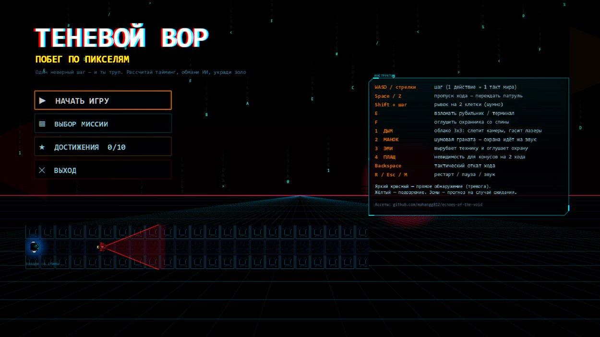
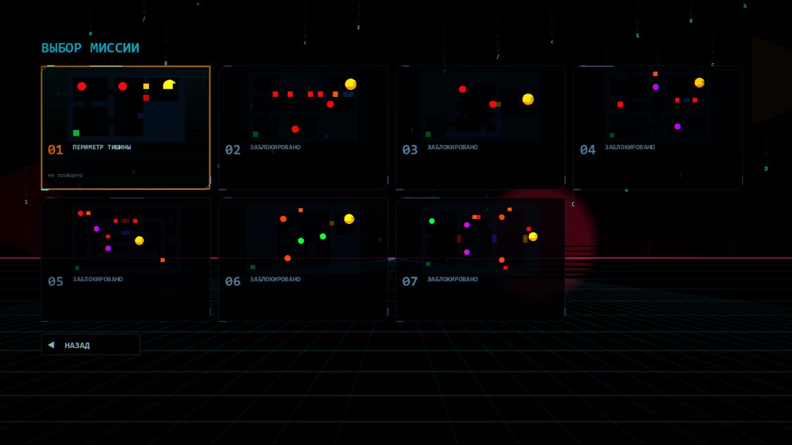
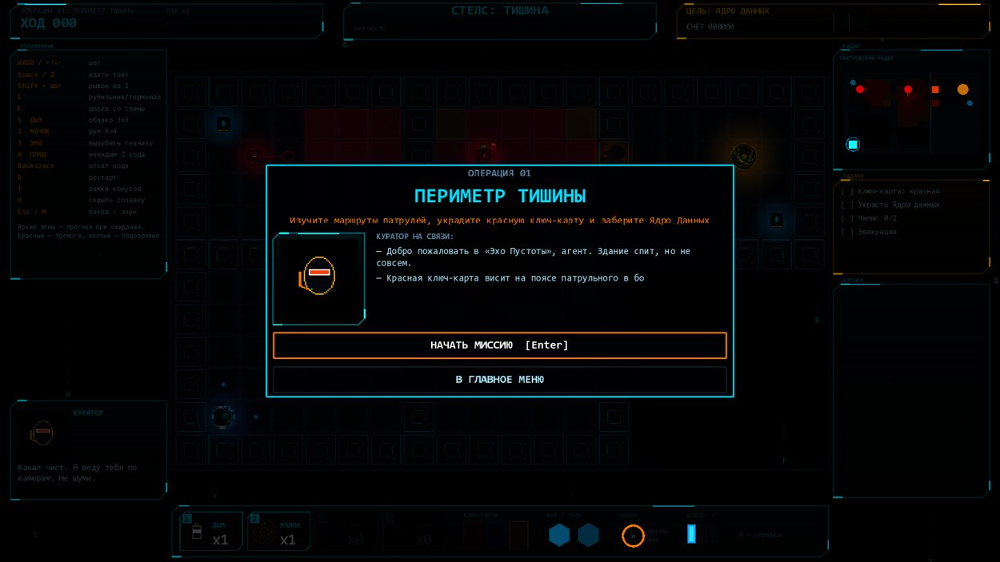
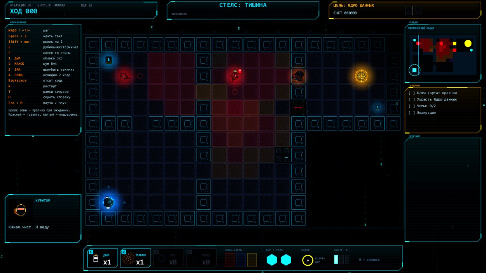
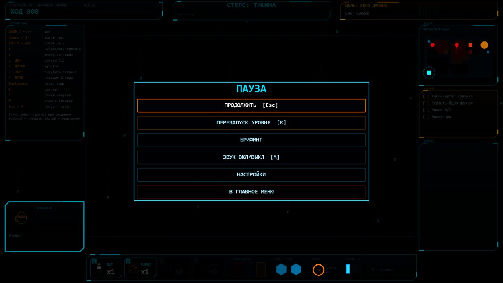
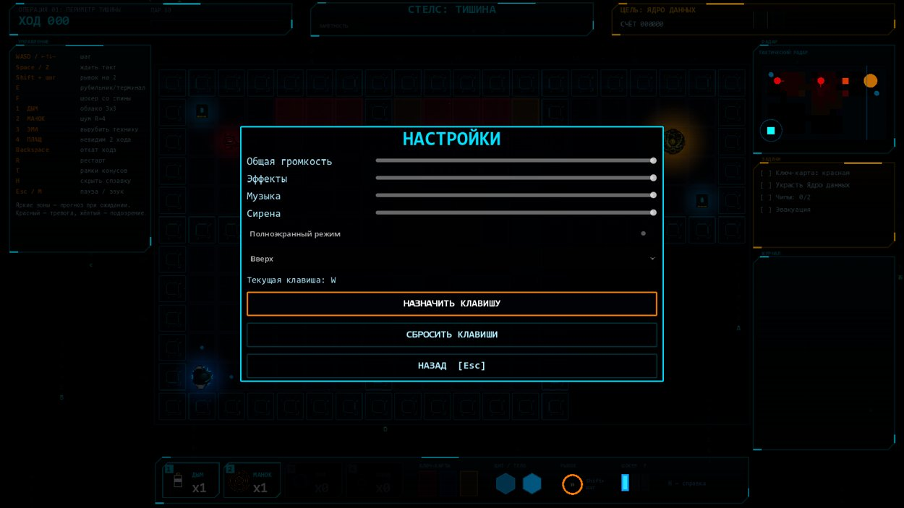
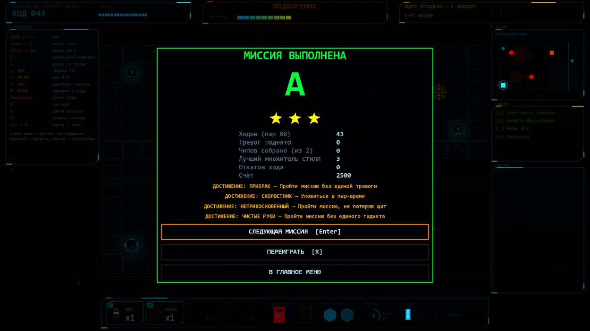
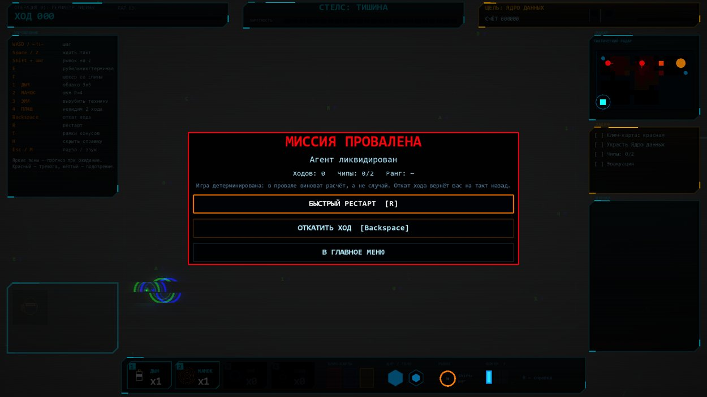

# Руководство пользователя

«Теневой вор: Побег по пикселям» — пошаговый тактический стелс для Windows. Цель: украсть Ядро данных и вернуться на клетку старта без активной тревоги.

## Запуск

Дважды щёлкните `EchoesOfTheVoid.exe`. Редактор Godot не нужен. Выберите «Начать игру» или ранее открытый уровень. В брифинге нажмите Enter или «Начать миссию». Новые уровни открываются после эвакуации. Если есть сохранение, главное меню предлагает «Возобновить миссию».

## Управление по умолчанию

| Ввод | Действие |
|---|---|
| WASD или стрелки | Шаг; для вентиляции дважды нажмите одно направление |
| Shift + направление | Рывок на две свободные клетки, громче обычного шага |
| Space или Z | Подождать один такт |
| E | Переключить соседний рубильник или терминал |
| F | Оглушить патрульного или киберпса, если вы за ним и смотрите в его сторону |
| 1 / 2 | Выбрать дым или манок; цель — WASD/стрелки/мышь, бросок — Space/Enter/E/ЛКМ, отмена — Esc/ПКМ |
| 3 / 4 | ЭМИ вокруг себя / плащ |
| Backspace | Откат последнего такта |
| R / Esc | Рестарт / пауза; в режиме наведения Esc отменяет наведение |
| T / H / M | Текущие конусы / справка / весь звук вкл. или выкл. |

## Как пройти миссию

1. Изучите маршрут охраны. Тонкие рамки — текущее зрение, яркие клетки — прогноз следующего такта **при ожидании**. Жёлтый сектор вызывает подозрение, красный — тревогу.
2. При необходимости украдите карту. Для этого подойдите к охраннику вплотную вне зон зрения, пока он не преследует вас. Дверь открывается шагом с подходящей картой.
3. Старайтесь входить в шкаф из необозреваемой клетки. Дым защищает от конусов и лазеров. Лазер сам не ранит, но закрывает эвакуацию, пока идёт тревога.
4. Возьмите Ядро и вернитесь. При тревоге оторвитесь от охраны и переждите шесть тактов без повторной детекции; счётчик виден на HUD. Чипы — дополнительные цели. Для S нужны все чипы, ноль тревог и число ходов не выше пар-времени.

## Сохранения, настройки и типовые проблемы

Принятый ход сохраняется автоматически; победа или ручной рестарт завершают текущую контрольную запись. В главном меню команда «Возобновить миссию» восстанавливает последнюю незавершённую игру, включая историю отката. При повреждённом профиле игра пробует резервную копию; если это не удалось, предлагает создать новый профиль или играть без записи.

В паузе откройте «Настройки»: общая громкость, эффекты, музыка и сирена регулируются отдельно; там же включается полноэкранный режим и меняются основные клавиши. Клавиши быстрой справки и альтернативные стрелки/Space остаются фиксированными.

Профили Windows находятся в `%APPDATA%\Godot\app_userdata\Теневой вор- Побег по пикселям`. Для обычного запуска удалять файлы не требуется.

## Приложение. Внешний вид

